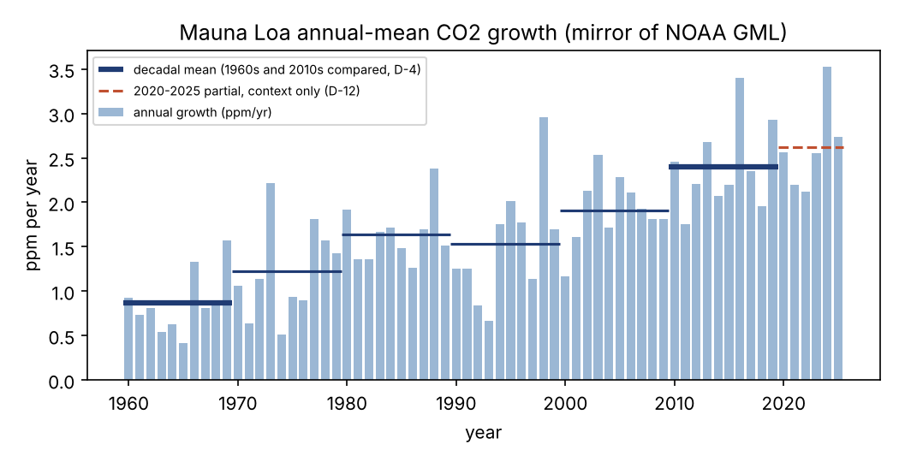

# Mauna Loa CO2 Growth Rate, 1960s–2010s

*Internal smoke-test report, run smoke-v02-co2-2026-10-10. Descriptive only:
this report describes how fast CO2 rose; it does not explain why.*

## Summary

The yearly increase in atmospheric CO2 at Mauna Loa averaged 0.86 parts per
million (ppm) per year in the 1960s and 2.40 ppm per year in the 2010s. A
straight-line trend fitted to the yearly increases over 1960–2019 also rises.
Both conditions of the rule fixed before the analysis were met, so the run
records the growth rate as having **increased**. The rise was not steady in
every decade: the 1990s average (1.53) was slightly below the 1980s (1.64),
a small difference that shrinks (to 0.04) but keeps its sign when decade boundaries are shifted.

## Data

Annual mean CO2 at Mauna Loa, 1959–2025, as published by the `datasets/co2-ppm`
GitHub mirror of NOAA GML
(`https://raw.githubusercontent.com/datasets/co2-ppm/main/data/co2-annmean-mlo.csv`,
accessed 2026-10-10, sha256 b1548ede…c33c4; licence ODC-PDDL-1.0; NOAA public-
domain terms). Original data: Tans (NOAA/ESRL) and Keeling (Scripps Institution
of Oceanography). NOAA's own server could not be reached from the analysis
environment, so the values were not cross-checked against NOAA's current
release, and NOAA may revise recent values. Only yearly increases for 1960–2019 enter
the comparison.

## Method

- **Yearly increase**: this year's annual mean minus last year's. The first
  value is 1960 minus 1959.
- **Decadal average**: the mean of the ten yearly increases in a decade (1960–
  1969 is "the 1960s"). Because the increases add up, a decade's average equals
  (last year's level − the level ten years earlier) ÷ 10, so it depends on just
  two annual values. A single unusual year at a decade boundary can move it.
- **Trend**: a straight line fitted to the yearly increases, 1960–2019, which
  uses every year and so is less sensitive to boundary years.
- **Rule** (fixed before results were computed): the growth rate counts as
  increased only if the 2010s average exceeds the 1960s average **and** the
  trend slopes upward.

## Results

| Decade | Average yearly increase (ppm/yr) |
|---|---|
| 1960s | 0.86 |
| 1970s | 1.22 |
| 1980s | 1.64 |
| 1990s | 1.53 |
| 2000s | 1.91 |
| 2010s | 2.40 |

The trend line rises by about 0.028 ppm/yr per year. Shifting every decade by
one year (1961–1970 … 2011–2020) gives 0.88 for the first decade and 2.41 for
the last.

The dashed 2020–2025 line in the figure is a partial period shown for context
only. It is not compared with the complete decades and supports no claim.

## Limitations

- Mirror source, not verified against NOAA's current release.
- Decadal averages depend on boundary years; the trend and shifted decades
  reduce but do not remove this.
- The trend's uncertainty estimate is descriptive only; no significance test
  is used for any claim.
- No literature review was done (deferred); the report must not be reused as a
  literature-grounded statement.
- All workflow approvals in this run are synthetic, and the researcher and
  reviewer were the same model family (open escalation E-1). Do not treat the
  result as independently reviewed.
